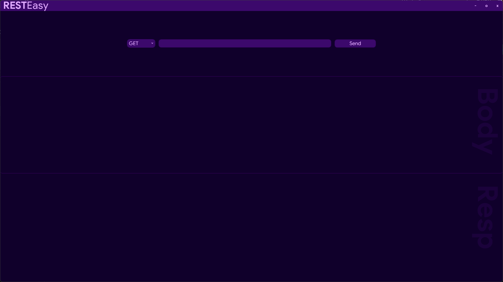
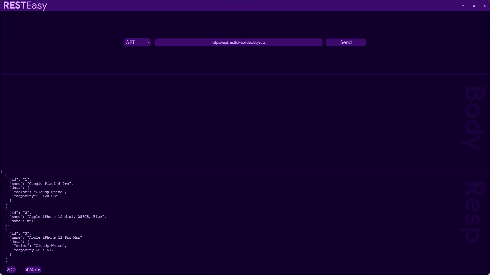
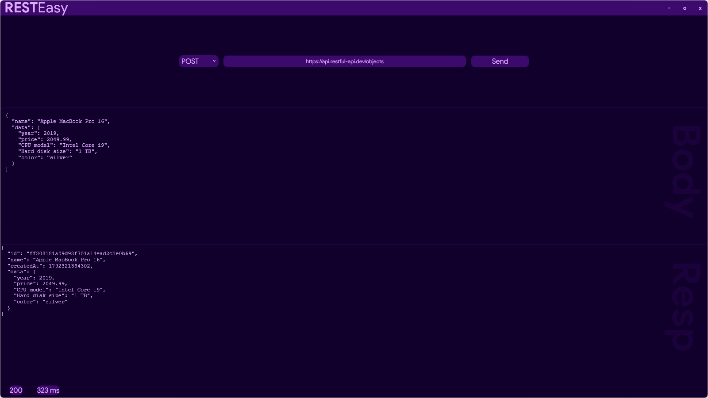
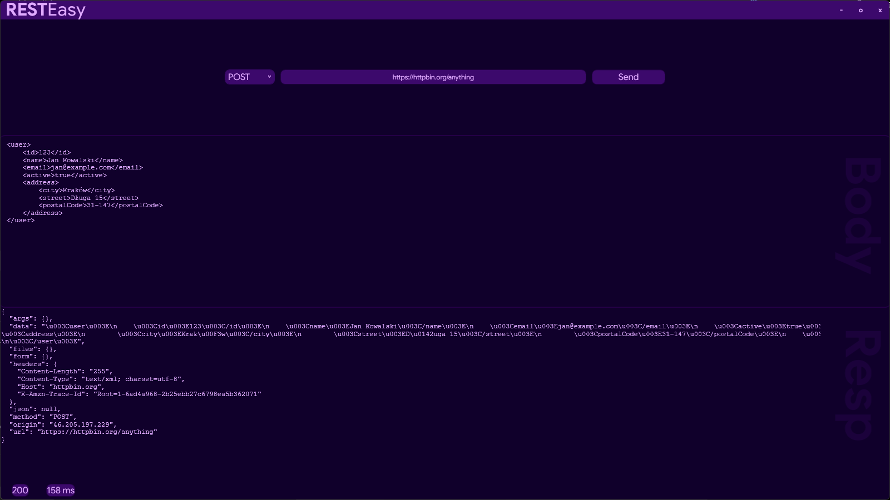
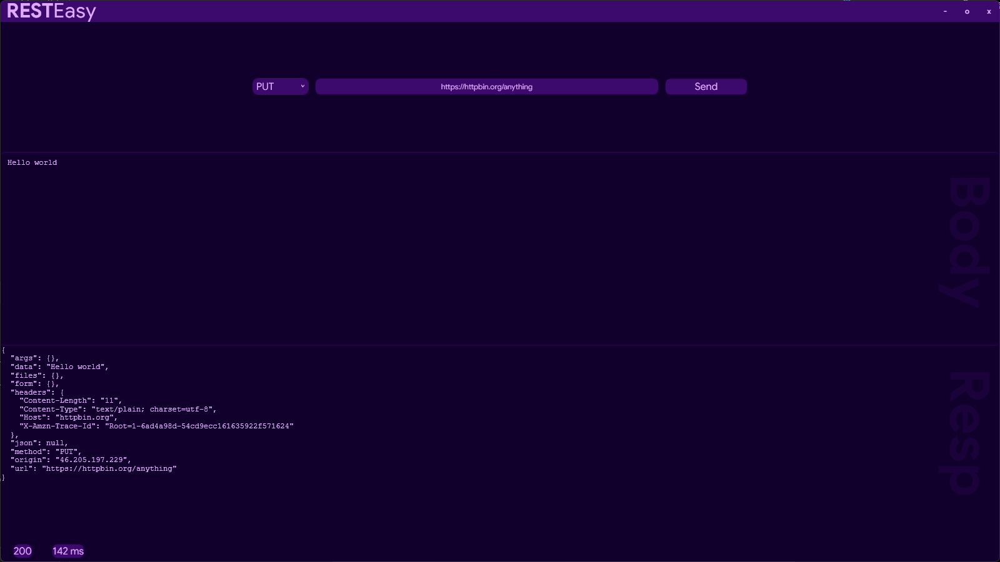

# 😌RESTEasy
**RESTEasy** is a Windows desktop application for sending and testing HTTP requests to REST APIs. It provides a simple interface for configuring requests and inspecting server responses.


## 🛠️Technologies
- ``C#``
- ``Windows Presentation Foundation (WPF)``
- ``.NET 10``
- ``Nunit``

## ⚙️Features
- Multiple request types available
- Send requests with JSON, XML, plain text, or an empty body
- Configure request URLs and HTTP headers
- View HTTP response status codes
- Measure and display response time in milliseconds
- Simple desktop interface for testing REST APIs
## 🚀 Getting Started

### Option 1: Download the application

1. Open the [Releases](https://github.com/RexTi71/RESTEasy/releases) page.
2. Download the latest release.
3. Run the application executable.

### Option 2: Run from source

**Requirements:**
- Windows 10 or later
- [.NET 10 SDK](https://dotnet.microsoft.com/download/dotnet/10.0)

1. Clone the repository:

   ```bash
   git clone https://github.com/RexTi71/RESTEasy.git
   ```

2. Navigate to the project directory containing the `.csproj` file.

3. Restore dependencies:

   ```bash
   dotnet restore
   ```

4. Run the application in Debug configuration:

   ```bash
   dotnet run
   ```

Alternatively, open the solution in Visual Studio, select the Debug configuration, and press `F5`.

 ## 🖼️Gallery

### Home screen

### GET request

### POST Request — JSON

### POST Request — XML

### PUT Request — Plain Text

